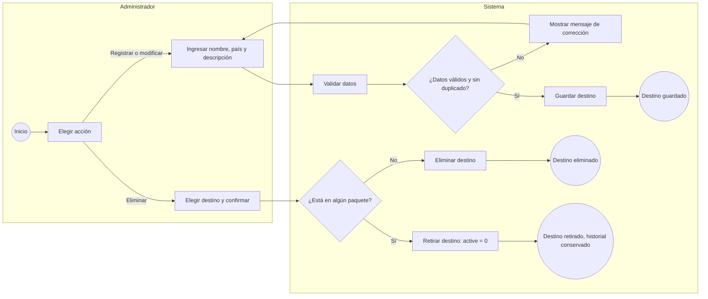
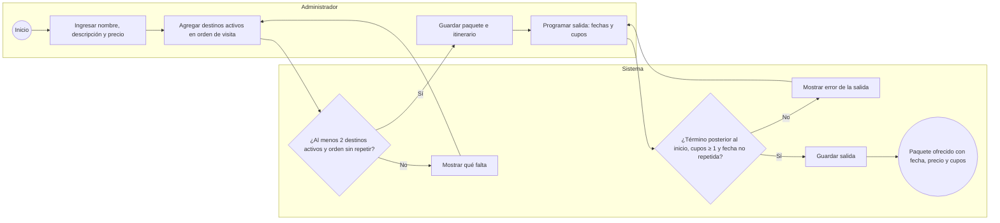
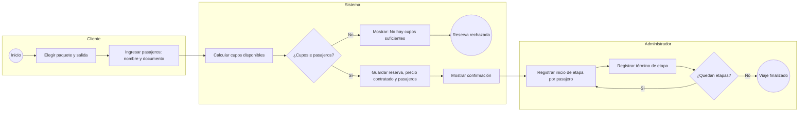
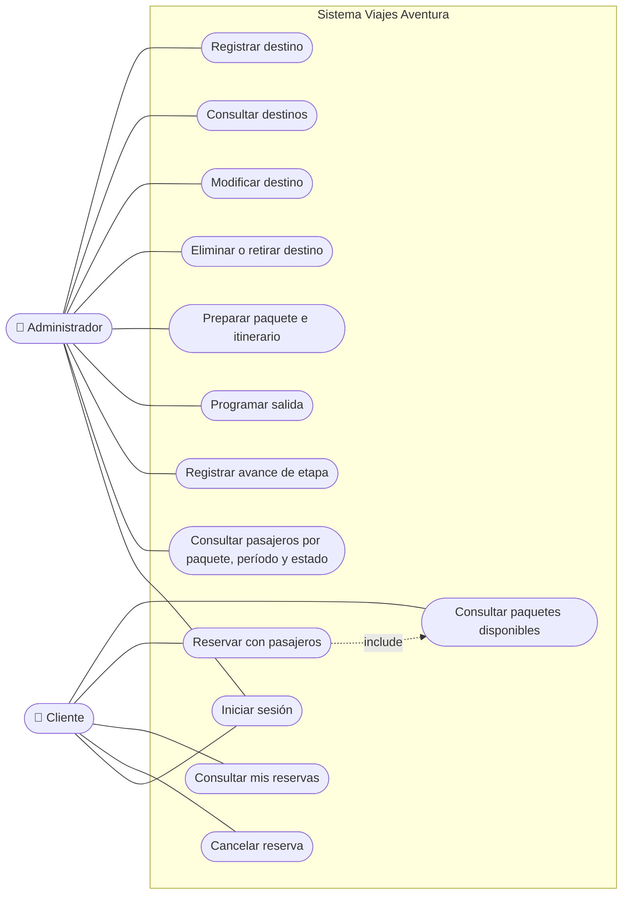
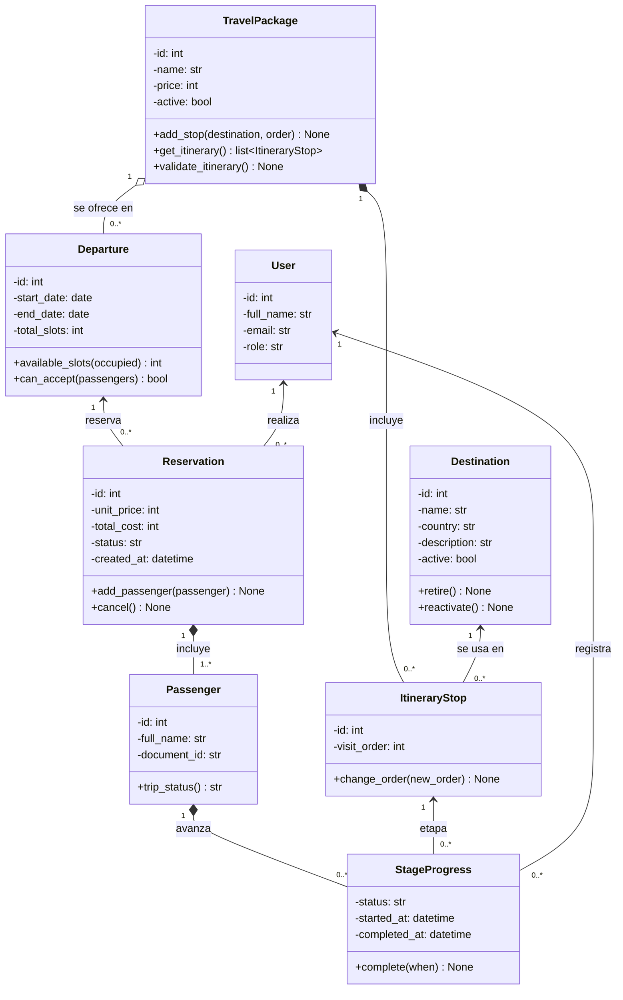
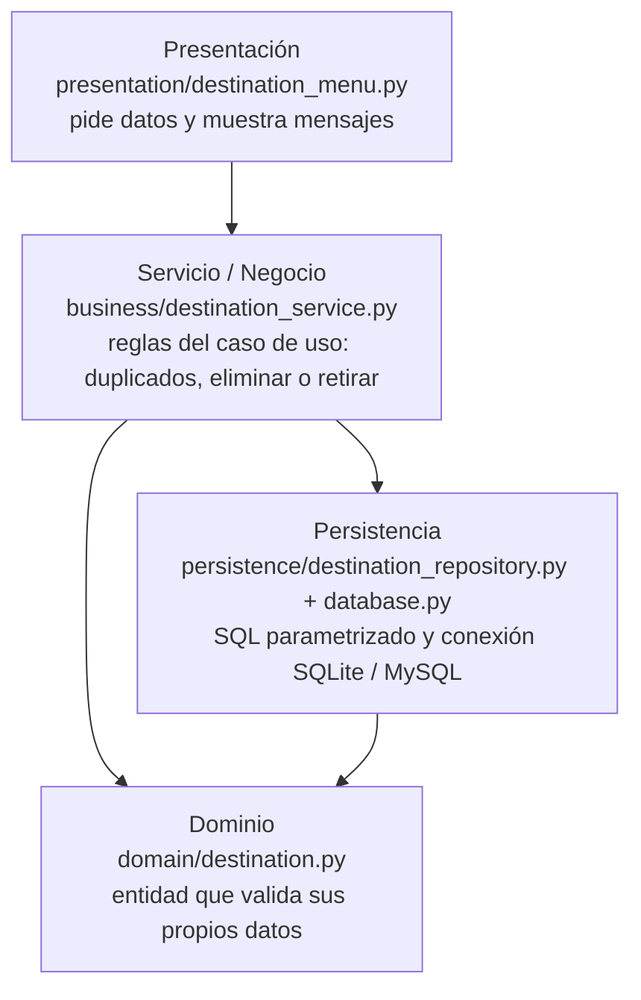

# Diseño integrado – Sprint 2

Cuatro perspectivas de la misma solución: procesos (BPMN), casos de uso, clases y base de datos ([modelo físico v2](modelo_fisico_v2.md)).
Los diagramas están en Mermaid; GitHub los dibuja automáticamente.

## Una regla vista en los cuatro modelos

**Regla R2:** *un destino usado en un paquete no se borra: se retira y conserva su historial.*

| Modelo | Cómo aparece |
|---|---|
| BPMN 1 | Decisión "¿Está en algún paquete?" → *Retirar destino* o *Eliminar destino* |
| Casos de uso | *Eliminar o retirar destino* (Administrador) |
| Clases | `Destination.active`, `Destination.retire()`; `DestinationService.remove()` decide |
| BD | `destinations.active`; `itinerary_stops.destination_id ON DELETE RESTRICT` |
| Código | `business/destination_service.py` → `remove()`; prueba `test_used_destination_is_retired_not_deleted` |

---

## BPMN 1 · Gestión de destinos

## BPMN 2 · Preparación de paquetes

## BPMN 3 · Reserva y seguimiento del viaje

---

## UML de casos de uso

| Hito | Casos de uso |
|---|---|
| 1 · Destinos | UC1–UC4 (CRUD implementado en este sprint) |
| 2 · Paquetes | UC5, UC6, UC7 |
| 3 · Reservas y viaje | UC8–UC12 |
| Transversal | UC13 |

---

## UML de clases (dominio)

### Justificación de las relaciones

| Relación | Multiplicidad | Por qué |
|---|---|---|
| TravelPackage – ItineraryStop | 1 a 0..* (composición) | Una etapa no existe sin su paquete. En preparación puede tener 0; para ofrecerlo, `validate_itinerary()` exige al menos 2. |
| Destination – ItineraryStop | 1 a 0..* | Un mismo destino se reutiliza en muchos paquetes (Hito 1). |
| TravelPackage – Departure | 1 a 0..* | El mismo paquete se ofrece en distintas fechas con cupos propios (Hito 2). |
| Departure – Reservation | 1 a 0..* | Las reservas de dos fechas distintas quedan separadas. |
| Reservation – Passenger | 1 a 1..* (composición) | Una reserva es para uno o varios pasajeros; cada uno ocupa un cupo. |
| Passenger – StageProgress | 1 a 0..* | Permite saber qué etapas completó y cuál cursa (Hito 3). |
| User – StageProgress | 1 a 0..* | Guarda qué administrador registró cada avance. |

---

## Arquitectura por capas

| Capa | Hace | No hace |
|---|---|---|
| Presentación | `input()` / `print()`, captura errores y los muestra | No valida reglas ni usa SQL |
| Servicio | Coordina el caso de uso y aplica reglas (duplicado, política de borrado) | No conoce el motor de BD |
| Dominio | Valida nombre, país y descripción; `retire()` / `reactivate()` | No sabe guardar |
| Persistencia | SQL con parámetros `?`; traduce a `%s` en MySQL; convierte errores del motor en `DatabaseError` | No decide reglas del negocio |

---

## Revisión del diseño con IA

| Sugerencia de la IA | Comprobación con datos ficticios | Decisión |
|---|---|---|
| "Si `packages` guarda fechas y cupos, no se puede ofrecer el mismo paquete en dos fechas." | Intentar *Ruta del Vino* en enero y en febrero con el modelo v1: había que duplicar el paquete. | **Aceptada:** tabla `departures`. Pregunta 3. |
| "Guardar `available_slots` puede quedar desincronizado al cancelar." | Cancelar la reserva 5 (2 pasajeros) y revisar la salida 3: con el cálculo da 11 disponibles sin tocar nada más. | **Aceptada:** los cupos se calculan. Preguntas 3 y 5. |
| "Si se edita el itinerario de un paquete, las reservas antiguas mostrarían el itinerario nuevo." | Reserva 4 de *Costa y Capital*: si se cambiara Valparaíso por otro destino, el historial cambiaría. | **Aceptada como regla de negocio:** no se edita el itinerario de un paquete con salidas; se crea uno nuevo. Se evaluó copiar el itinerario en cada reserva y se **descartó** por duplicar datos. |
| "Guardar el estado del pasajero (pendiente/viajando/finalizado) en una columna." | Con la consulta derivada de `stage_progress` se obtienen los mismos conteos (pregunta 6). | **Descartada:** una columna podría contradecir los avances registrados. |
