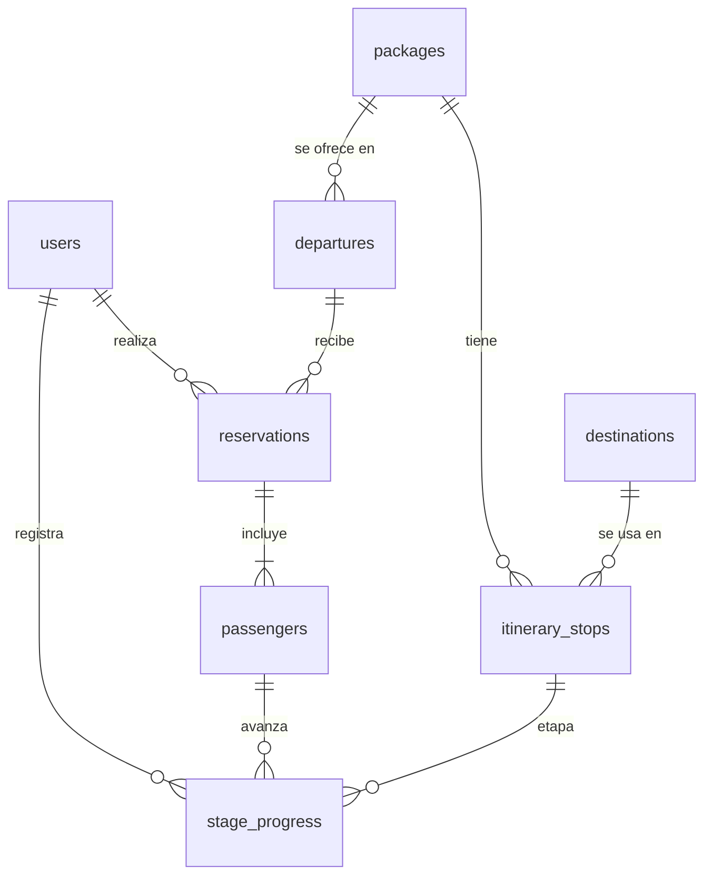

# Modelo físico v2 – Viajes Aventura

Scripts: [`persistence/schema_sqlite.sql`](../persistence/schema_sqlite.sql) y [`persistence/schema_mysql.sql`](../persistence/schema_mysql.sql) (mismas tablas, claves y reglas).
Datos de ejemplo: [`persistence/seed_data.sql`](../persistence/seed_data.sql) (válido para ambos motores).

## Reglas del negocio que definen el modelo

| # | Regla | Dónde queda en la BD |
|---|---|---|
| R1 | Los destinos no se venden sueltos: no tienen precio. | `destinations` sin columna de costo |
| R2 | Un destino usado en un paquete no se borra: se **retira** y conserva su historial. Si nunca se usó, se puede borrar. | `destinations.active` + `itinerary_stops.destination_id ON DELETE RESTRICT` |
| R3 | Un paquete combina destinos en un **orden de visita**. | `itinerary_stops.visit_order`, `UNIQUE (package_id, visit_order)` |
| R4 | El precio por persona es **fijo por paquete** y no cambia. | `packages.price` |
| R5 | Un paquete se ofrece en **distintas fechas**, cada una con cupos propios. | `departures` (`UNIQUE (package_id, start_date)`) |
| R6 | Una reserva es de una salida concreta y guarda las condiciones contratadas. | `reservations.departure_id`, `unit_price`, `total_cost` |
| R7 | Una reserva tiene uno o varios **pasajeros**; cada pasajero ocupa un cupo. | `passengers` |
| R8 | El administrador registra el avance de cada pasajero por cada etapa, con fecha y responsable. | `stage_progress` (`recorded_by`, `started_at`, `completed_at`) |
| R9 | Los cupos disponibles **se calculan**, no se guardan: `total_slots` − pasajeros de reservas confirmadas. | consulta, ver pregunta 5 en [validacion_bd.md](validacion_bd.md) |

## Diagrama entidad-relación

## Tablas

### users (sin cambios respecto de v1)
id (PK), full_name, email (UNIQUE), password_hash, role (`admin`/`client`), failed_attempts, locked_until, created_at.

### destinations — tabla maestra del CRUD
| Columna | SQLite | MySQL | Restricciones |
|---|---|---|---|
| id | INTEGER | INT AUTO_INCREMENT | PK |
| name | TEXT | VARCHAR(100) | NOT NULL; `UNIQUE (name, country)` |
| country | TEXT | VARCHAR(60) | NOT NULL |
| description | TEXT | VARCHAR(500) | puede ser nulo |
| active | INTEGER | TINYINT | NOT NULL, 0 o 1, por defecto 1 |
| created_at | TEXT | DATETIME | NOT NULL, fecha actual |

La unicidad es por **nombre y país**: existen Santiago de Chile y Santiago de Cuba.

### packages
| Columna | SQLite | MySQL | Restricciones |
|---|---|---|---|
| id | INTEGER | INT AUTO_INCREMENT | PK |
| name | TEXT | VARCHAR(120) | NOT NULL, UNIQUE |
| description | TEXT | VARCHAR(500) | puede ser nulo |
| price | INTEGER | INT | NOT NULL, > 0 (pesos por persona) |
| active | INTEGER | TINYINT | NOT NULL, 0 o 1 |
| created_at | TEXT | DATETIME | NOT NULL |

### itinerary_stops (antes `package_destinations`)
| Columna | Tipo | Restricciones |
|---|---|---|
| id | INTEGER / INT | PK |
| package_id | INTEGER / INT | FK → packages, `ON DELETE CASCADE` |
| destination_id | INTEGER / INT | FK → destinations, `ON DELETE RESTRICT` |
| visit_order | INTEGER / INT | NOT NULL, ≥ 1, `UNIQUE (package_id, visit_order)` |

Tiene `id` propio porque `stage_progress` apunta a cada etapa. Se permite repetir un destino en distintas posiciones (por ejemplo, salir y volver a Santiago).
La regla "al menos dos destinos para ofrecer el paquete" se valida en la capa de negocio (no se puede expresar con un CHECK).

### departures (salidas) — nueva
| Columna | SQLite | MySQL | Restricciones |
|---|---|---|---|
| id | INTEGER | INT AUTO_INCREMENT | PK |
| package_id | INTEGER | INT | FK → packages, `RESTRICT` |
| start_date | TEXT `AAAA-MM-DD` | DATE | NOT NULL; `UNIQUE (package_id, start_date)` |
| end_date | TEXT | DATE | NOT NULL, `end_date > start_date` |
| total_slots | INTEGER | INT | NOT NULL, ≥ 1 |

### reservations
| Columna | Tipo | Restricciones |
|---|---|---|
| id | INTEGER / INT | PK |
| user_id | INTEGER / INT | FK → users (quién reservó), `RESTRICT` |
| departure_id | INTEGER / INT | FK → departures, `RESTRICT` |
| unit_price | INTEGER / INT | NOT NULL, > 0 — precio por persona al reservar |
| total_cost | INTEGER / INT | NOT NULL, > 0 — `unit_price × pasajeros` |
| status | TEXT / VARCHAR(10) | `confirmed` o `cancelled` |
| created_at | TEXT / DATETIME | NOT NULL |

### passengers — nueva
| Columna | Tipo | Restricciones |
|---|---|---|
| id | INTEGER / INT | PK |
| reservation_id | INTEGER / INT | FK → reservations, `RESTRICT` |
| full_name | TEXT / VARCHAR(120) | NOT NULL |
| document_id | TEXT / VARCHAR(20) | NOT NULL (RUT o pasaporte); `UNIQUE (reservation_id, document_id)` |

### stage_progress — nueva
| Columna | Tipo | Restricciones |
|---|---|---|
| id | INTEGER / INT | PK |
| passenger_id | INTEGER / INT | FK → passengers |
| itinerary_stop_id | INTEGER / INT | FK → itinerary_stops |
| status | TEXT / VARCHAR(12) | `in_progress` o `completed` |
| started_at | TEXT / DATETIME | NOT NULL |
| completed_at | TEXT / DATETIME | nulo mientras cursa; `>= started_at` |
| recorded_by | INTEGER / INT | FK → users (administrador responsable) |

`UNIQUE (passenger_id, itinerary_stop_id)`: un avance por pasajero y etapa. Sin fila = etapa no iniciada.
El estado del pasajero se **deriva**: sin avances = *pendiente*; todas las etapas completadas = *finalizado*; si no, *viajando*.

## Reglas de borrado

| Si se intenta borrar… | Qué pasa |
|---|---|
| Un destino usado en un paquete | La BD lo impide (`RESTRICT`); la capa de negocio lo **retira** (`active = 0`) |
| Un destino nunca usado | Se borra |
| Un paquete con salidas | Se impide (`RESTRICT`); se desactiva con `packages.active = 0` |
| Una salida, reserva, pasajero o avance | Se impide: es historial |

## Cambios respecto de v1

1. `destinations`: se quita `cost` (R1), se agrega `active` (R2) y la unicidad pasa a `(name, country)`.
2. `packages`: se agrega `price` fijo (R4); fechas y cupos pasan a `departures` (R5).
3. `package_destinations` → `itinerary_stops` con `visit_order` (R3).
4. `reservations` apunta a la salida, no al paquete, y guarda `unit_price` (R6). Se quita `people`: se cuenta con `passengers`.
5. Nuevas tablas `departures`, `passengers` y `stage_progress`.
6. Script equivalente para MySQL 8 (InnoDB, `DATE`/`DATETIME`, restricciones con nombre).
7. Se resuelve el pendiente de v1 sobre RF13: los paquetes no se borran, se desactivan.
